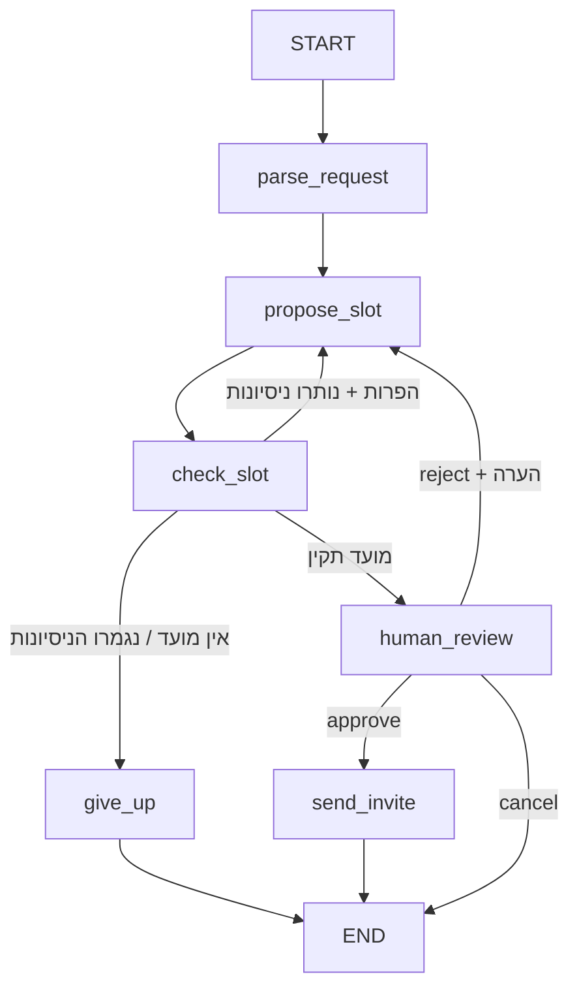
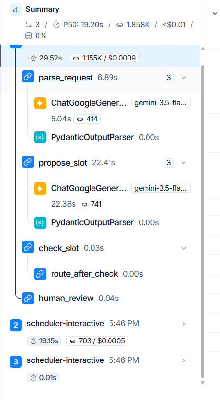

# מתאם פגישות עם אילוצים – LangGraph + LangSmith

סוכן שמקבל בקשה בעברית חופשית ("שעה עם דנה ויוסי ביום ראשון אחרי 12:00"), מחלץ ממנה אילוצים, מציע מועד שמתאים ליומנים של כל המשתתפים, מבקש אישור מהמשתמש ו"שולח" זימון.

## עמידה בדרישות

| דרישה | איך היא מתממשת |
|---|---|
| LangGraph | `scheduler/graph.py`: `StateGraph` עם 6 צמתים |
| לולאה או ענף מותנה | **לולאה 1:** `check_slot` → `propose_slot` כשהמועד מפר אילוץ (עד `max_attempts` ניסיונות). **לולאה 2:** דחייה של המשתמש מחזירה ל-`propose_slot` עם ההערה שלו. **ענף מותנה:** `route_after_check` |
| interrupt / human-in-the-loop | `human_review` קורא ל-`interrupt()`. ההמשך מתבצע עם `Command(resume=...)` |
| דאטהסט והערכה ב-LangSmith | 25 בקשות (17 עם מועד אפשרי ו-8 בלי), 3 evaluators |
| ניסוי לפני ואחרי | `baseline` מול `improved` |

## מבנה הגרף



* `parse_request` (LLM): מחלץ משתתפים, משך, טווח תאריכים ושעות לפי סכמת Pydantic.
* `propose_slot` (LLM): מציע מועד, ובניסיון חוזר מקבל גם את רשימת ההפרות מהניסיון הקודם.
* `check_slot` (קוד דטרמיניסטי, ללא LLM): בודק התנגשויות ביומנים, שעות עבודה, ימי שישי ושבת וטווח תאריכים.
* `human_review` (interrupt): המשתמש מאשר, דוחה עם הערה או מבטל.

## התקנה והרצה

```bash
pip install -r requirements.txt
cp .env.example .env          # למלא מפתחות

python run_interactive.py "שעה עם דנה ויוסי ביום ראשון"   # הדגמת human-in-the-loop
python run_interactive.py --draw                            # הדפסת הגרף כ-Mermaid

python create_dataset.py                                    # פעם אחת
python run_experiment.py --variant baseline
python run_experiment.py --variant improved
```

## הערכה

| Evaluator | מה הוא בודק |
|---|---|
| `slot_correct` (המדד הראשי) | האם המועד תקין לפי האילוצים **הנכונים** מהדאטהסט, ולא לפי מה שהמודל הבין. כשאין מועד אפשרי, נבדק שהמערכת החזירה `no_slot` |
| `parse_correct` | אחוז השדות שחולצו נכון מהבקשה |
| `attempts` | כמה ניסיונות הצעה נדרשו |

הבדיקה כולה דטרמיניסטית (`calendar_utils.validate_slot`), כך שהמדד לא תלוי בשיפוט של מודל.

בזמן ההערכה אין אדם שיאשר, ולכן `run_auto` מריץ עם `auto_approve=True` וצומת `human_review` מאשר אוטומטית.

## הניסוייםpython create_dataset.py

| גרסה | `max_attempts` | טבלת תאריכים בפרומפט | slot_correct | parse_correct | attempts |
|---|---|---|---|---|---|
| baseline | 1 | לא | __ | __ | __ |
| improved | 3 + משוב הפרות | כן | __ | __ | __ |


## צילומי trace


*trace שבו `propose_slot` רץ פעמיים: ההצעה הראשונה התנגשה ביומן של יוסי, ובניסיון השני ההפרה הועברה למודל והוא תיקן.*


*הריצה נעצרת ב-`human_review` וממשיכה אחרי `Command(resume=...)`.*

## התובנה מה-traces

> **למלא אחרי ההרצה.** דוגמה למה שכדאי לחפש:
>
> ב-traces של ה-baseline רואים שבחלק ניכר מהכישלונות ה-`parse_request` המיר "יום שלישי" לתאריך שגוי. המודל חישב בעצמו את היום בשבוע וטעה. כל השלבים שאחריו עבדו על תאריך לא נכון, ולכן ציון ה-`slot_correct` נפל גם כשההצעה עצמה הייתה "תקינה" מבחינת `check_slot`. הוספת טבלת תאריכים מפורשת לפרומפט פתרה את רוב המקרים האלה. לולאת התיקון טיפלה בהתנגשויות ביומן, שאותן המודל מפספס כשיש הרבה טווחי "עסוק".

נקודות שכדאי לבדוק ב-traces:
1. ב-`parse_request`: האם התאריכים נכונים, ואיך המודל פירש "אחרי" ו"עד".
2. ב-`propose_slot`, בניסיון השני: האם המודל באמת התייחס להפרות.
3. דוגמאות שבהן אין מועד אפשרי: האם המודל "המציא" מועד, ואז `check_slot` דחה אותו עד שנגמרו הניסיונות (סטטוס `failed` במקום `no_slot`).

## שיפור נוסף (אופציונלי)

`--variant improved_plus` נותן למודל את רשימת החלונות הפנויים שחושבה בקוד. השאלה המעניינת היא האם עדיף שהמודל "יחשוב" בעצמו, או שמחשבים בקוד ומשאירים למודל רק את ההבנה של השפה.
